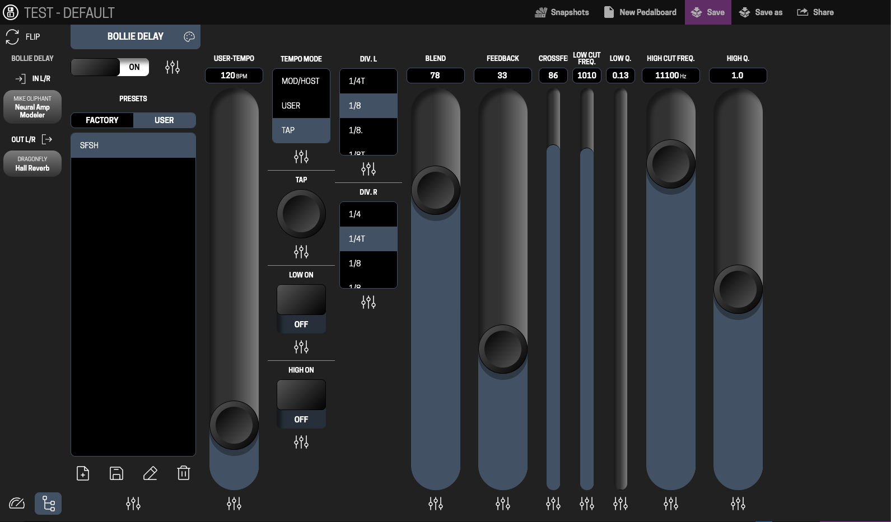

# mod-ui-nhe

Extensions for the [MOD](https://mod.audio) web UI (MOD Duo, Duo X, Dwarf, MOD Desktop), kept **outside MOD's code**.



## What it adds

- **A new plugin settings screen.** A pedal's gear opens big, touch-friendly controls in place of MOD's knobs: sliders, toggles, triggers, option lists, presets and file lists (NAM models, IRs), stacked into columns that fit the screen and scroll sideways. A system bar on the left shows tempo, CPU / RAM and the signal chain; tap a neighbouring plugin to jump to it. The **NHE / MOD** switch at the top right brings back MOD's own panel.
- **A clearer assignment dialog.** A control's settings icon opens one screen for assigning it to a footswitch, knob, MIDI, Control Chain or CV, with its label, range and options.
- **Plugin colours.** Give each plugin one of MOD's colours in place of the purple.
- **A live surface.** In a control's assignment dialog, **Add to surface** puts it on one screen with the controls you picked from other plugins, each plugin's under its name in its colour. The star at the left of the bottom bar opens it. Its **Morph targets** tab records two positions of up to 10 of its sliders and moves them all between the two with one Morph slider, which a knob, MIDI or an expression pedal can drive (on the MOD, through CV addressing).
- **A gallery view** (the performance view). The gallery icon in the footer shows your pedals one at a time, as big as the screen allows. **Flip** a pedal to get to its settings on the back; **Hide** the ones you don't need while playing.

Values, presets and assignments all go through MOD's own code, so everything stays in step with MOD's editor, the device and other browsers. On the device NHE adds its own folder and two small hooks into MOD's page, and nothing else (see "How it fits into MOD").

## Install it on your MOD

### The easy way: double-click

1. **Download** [nhe-installer.zip](https://github.com/Kiwooky/MOD-ui-NHE/releases/latest/download/nhe-installer.zip) (the latest release) and unzip it.
2. **Connect the MOD** over USB and wait until http://192.168.51.1 opens MOD's page in your browser.
3. **Run the installer** in the unzipped folder:
   - **Mac:** double-click `Install NHE.command`. The first time, macOS blocks it because it was downloaded: right-click it, choose **Open**, then **Open** again (on macOS 15 and later: **System Settings → Privacy & Security → Open Anyway**).
   - **Windows 10 / 11:** double-click `Install NHE (Windows).bat`. If Windows warns about it, choose **More info → Run anyway**.
4. Press Return for the usual address, then type the MOD's password when asked: `mod`. Reload http://192.168.51.1.

Run it again to update, and after every MOD OS update (which removes NHE's hooks). `Uninstall NHE.command` / `Uninstall NHE (Windows).bat` put MOD's own page back.

### From a terminal

You need a Mac or Linux computer (on Windows, use [WSL](https://learn.microsoft.com/windows/wsl/)) and your MOD device connected over USB.

1. **Get this repository.** Either `git clone https://github.com/Kiwooky/MOD-ui-NHE.git`, or on GitHub choose **Code → Download ZIP** and unzip it.
2. **Connect the MOD** over USB and check that http://192.168.51.1 opens MOD's web UI in your browser.
3. **Run the installer** from the repository's folder, in a terminal:

   ```sh
   sh tools/deploy.sh
   ```

   It asks for the MOD's password twice: it is `mod`. (Run `ssh-copy-id root@192.168.51.1` once and it won't ask again.)
4. **Reload** http://192.168.51.1. No reboot is needed.

For a MOD on your network instead of USB, add its address: `sh tools/deploy.sh 192.168.1.50`.

- **Update:** get the new version of the repository and run `sh tools/deploy.sh` again.
- **After a MOD OS update:** run `sh tools/deploy.sh` again (the update removes the hooks).
- **Uninstall:** `ssh root@192.168.51.1 'sh /data/nhe/device/uninstall.sh'` puts MOD's original page back.
- Use **one MOD tab at a time**: MOD's UI expects one browser, and a second tab can hang on "Loading pedalboard…".

Status and what's next: [ROADMAP.md](ROADMAP.md).

### On a Raspberry Pi (Patchbox OS / MODEP)

Activate MODEP on the Pi first (`sudo patchbox module activate modep`; http://patchbox.local should show MOD's UI). Then, from this folder on your computer:

```sh
sh tools/deploy.sh --patchbox            # or: sh tools/deploy.sh --patchbox 192.168.1.40
```

It logs in as `patch` and asks for that user's password (for ssh, then for sudo on the Pi). NHE goes to `/var/modep/nhe`.

**A touch screen on the Pi (kiosk).** To have MOD's UI open full screen on a screen attached to the Pi, run this once **on the Pi** (it needs the internet: it installs X and Chromium):

```sh
sudo sh /var/modep/nhe/device/kiosk/install.sh
```

From then on the Pi boots into MOD's UI. Settings are in `/etc/default/nhe-kiosk` (`sudo systemctl restart nhe-kiosk` after a change):

- **`SCALE`**: how much larger to draw everything. `auto` works it out from the size the screen reports: 1.25 on a 5" 800 × 480, 1 on a 7" 800 × 480, up to 1.5 on denser screens. Many cheap screens report no size or a wrong one, and then auto stays at 1. If that happens, set a number yourself, for example `SCALE=1.25`. `journalctl -u nhe-kiosk` shows what auto chose and why.
- **`X_ARGS=-nocursor`** hides the pointer. Leave it empty if you use a mouse.

To make NHE's own bars, screens and dialogs larger on top of that (the top and bottom bars, the plugin settings screen, NHE's builder, SET), use SET → **Screen size**: Auto, Larger (×1.15), Large (×1.3) or Largest (×1.5). It applies to that browser only, so the Pi's screen and your laptop each keep their own. Auto leaves them as they are: phones and tablets already size the page for their screen, and the kiosk's `SCALE` handles the Pi. When the bottom bar runs out of room, it first drops the open screen's name, then shortens the CPU / RAM meters, then drops their icon, and finally zooms the bars only as far as they fit.

`deploy.sh --patchbox` restarts the kiosk so it loads the new files. MOD's UI expects one browser, so while the kiosk shows it, opening http://patchbox.local on another computer can hang. Run `sudo systemctl stop nhe-kiosk` on the Pi to free it for a while. To take the kiosk away: `sudo sh /var/modep/nhe/device/kiosk/install.sh --remove`. Getting the screen itself working (its resolution, touch) is the Pi's own setup: see the screen maker's instructions, usually lines in `/boot/config.txt`.

### On Starless (19 or newer): a zip, no terminal

Starless has an installer for other web UIs in **Settings › Developer › User interfaces (EXPERIMENTAL)**. It takes a whole web UI, so NHE's zip is Starless's own UI with NHE inside it.

1. **Download** [nhe-starless.zip](https://github.com/Kiwooky/MOD-ui-NHE/releases/latest/download/nhe-starless.zip) (the latest release). Or build one yourself (Mac or Linux, from this folder): `npm run zip`, or `sh tools/package-zip.sh`. It downloads Starless's UI (github.com/sejerpz/mod-ui, branch `starless`), adds `nhe/` and the loader tag, and writes `dist/nhe-<version>.zip`.
2. **Install it** in the MOD's web UI: Settings › Developer › User interfaces, name it `nhe`, choose the zip (don't unpack it), **Install**, then pick **nhe** in the list. Reload.
3. **Switch back**: pick **Default** in the same list.

The zip carries a copy of Starless's UI as it was when you built it: rebuild it when Starless updates. Other sources: `--ref <branch or tag>`, `--repo <owner/repo>`, or `--html <folder>` for a html/ folder you have (see `sh tools/package-zip.sh --help`). Stock MOD OS has no such installer; use the steps above.

### Releasing (for maintainers)

Publish a release on GitHub (**Releases → Draft a new release**, a tag such as `v0.2.0`, notes). The **Release downloads** workflow (`.github/workflows/release.yml`) then builds `nhe-starless.zip` and `nhe-installer.zip` and attaches them, so the links above fetch the new version. When Starless updates its UI, rebuild a release from **Actions → Release downloads → Run workflow** with its tag.

## How it fits into MOD

On the device, NHE touches MOD's files in exactly two places:

1. a link `/usr/share/mod/html/nhe` → `/data/nhe` (where this repo's `nhe/` folder lives)
2. one `<script>` tag for `nhe/loader.js` in MOD's `index.html`

Everything else is in `/data`, so it survives reboots. A MOD OS update removes the two hooks; run the install script again to put them back.

```
nhe/
  loader.js              the one file index.html loads; reads version.json, loads features
  version.json           bumped on deploy so browsers fetch new files
  adapter/mod.js         the ONLY code that touches MOD's internals
  theme/tokens.css       design tokens (--nhe-*), exported from the Figma file's Variables
  components/            the NHE controls:
    icons.js             icons exported from the Figma file
    slider/              the slider that will replace MOD's knob
    controls/            toggle, trigger, plugin header, buttons, option list, preset list,
                         system bar (systembar.js), the panel layout with stacking (panel.js),
                         the addressing dialog (addressing.js), plugin colours (colour.js),
                         the name dialog (name.js)
  features/performance/  performance.js + .css (shared with the mod-ui branch) and index.js (wiring)
  features/settings/     the NHE plugin settings panel in MOD's settings window (NHE / MOD switch)
  device/install.sh      run on the device: hooks NHE into MOD's UI (safe to repeat)
  device/uninstall.sh    run on the device: restores MOD's original index.html
tools/
  devproxy.js            local preview: MOD's real UI + this repo's files, live
  deploy.sh              copy to the device and install
  package-zip.sh         a zip for Starless's User interfaces installer (npm run zip)
playground/              component playgrounds, no MOD needed (npm run playground)
docs/                    specs (slider, buttons, selects, system bar, addressing, plugin colour, performance flip)
test/                    browser tests (see test/README.md)
```

## Work on it locally (MOD Desktop)

1. Start **MOD Desktop**. It serves MOD's UI at http://127.0.0.1:18181.
2. In this folder: `npm run dev`. No `npm install` is needed; it uses Node built-ins only.
3. Open **http://localhost:18080**: MOD's real UI, with `./nhe` served live from this folder. Edit, reload, see it. Nothing in MOD Desktop is changed.

To preview against the Duo instead (over USB): `npm run dev:duo`.

MOD Desktop hides the device-only parts of the UI (File Manager, Banks, Plugin Store, Settings, hardware addressing). Work on those against the Duo.

## The settings panel

With the `settings` feature on (the default), a pedal's gear opens MOD's settings window with the NHE screen: sliders, toggles, triggers, option lists, presets, file lists and plugin on/off, stacked into columns. The **NHE / MOD** switch at the top right shows MOD's own panel instead. Values go through MOD's own path both ways, bindings show as shared or locked, and the addressing dialog, presets and on/off drive MOD's existing functions. Under the plugin's name: its user presets to and from a file (each preset is loaded once to read it, then the plugin goes back to how it was; a file is only taken for the plugin it was exported from, and its presets are added to the user presets; knob, switch and list settings only, not files such as models or IRs), its colour, its info page, and delete (after a yes; what fed it is then connected straight to what it fed, as if it were bypassed). The system bar sits on the left (tempo, CPU / RAM, the signal chain; EXIT closes the window). Text settings (e.g. Button to CV's texts) aren't handled yet: use the MOD view for those. The same screen is the back of a flipped pedal in the performance view.

Turn it off with `NHE.mod.setPreference('nhe-settings', 'false')`.

## Your settings

NHE's settings (plugin colours, which editor, builder and menus, the work surface, the performance view's layout, each board's cable colours, hand-laid cables and grid size in NHE's builder, and each board's live surface) are kept on the MOD itself, in MOD's own preferences (`nhe-config`): every browser that opens that MOD gets them, and two MODs keep their own. SET → **Settings file** exports them to a `.json` file, labelled with the MOD it came from, and imports one (into this MOD or another). `nhe/components/config.js` does it: it mirrors NHE's keys in the browser's localStorage, so features keep using localStorage as before.

## Try components on their own

`npm run playground`, then open http://localhost:18090/playground/slider.html (the slider with a properties panel, an event log, a sample settings panel and a theme-colour picker) or http://localhost:18090/playground/controls.html (every other control, the system bar, and a full settings panel laid out with stacking, at different heights). It needs no MOD. (The same page is at /playground/slider.html on the `npm run dev` proxy.) Open only the playground page on :18090, not its root: the root is MOD's UI, and MOD wants one tab at a time.

## Deploying while developing

`npm run deploy` is `tools/deploy.sh` (see "Install it on your MOD"): it copies `nhe/` to `/data/nhe`, then runs `device/install.sh` on the device, and stamps a new version so browsers fetch the new files.

## Switching features off

Each feature can be turned off with a MOD preference `nhe-<feature>` = `"false"`, stored on the device like MOD's own settings:

```js
NHE.mod.setPreference('nhe-performance', 'false')   // in the browser console; reload
```

## Requirements

- MOD OS 1.14 (tested against 1.14 RC4, `v1.14.0.3366`) or MOD Desktop on the same version.
- A browser at least as new as MOD 1.14 needs: iOS/iPadOS 13.4+; for the performance view, Safari 14.1+ or any current Chrome, Firefox or Edge.

## Licence

AGPL-3.0-or-later, like mod-ui ([LICENSE](LICENSE)). © 2026 New Horizon Electronics.

MOD, MOD Duo, Duo X, Dwarf and MOD Desktop are products of MOD Audio. This is an independent extension, not affiliated with or endorsed by MOD Audio.
