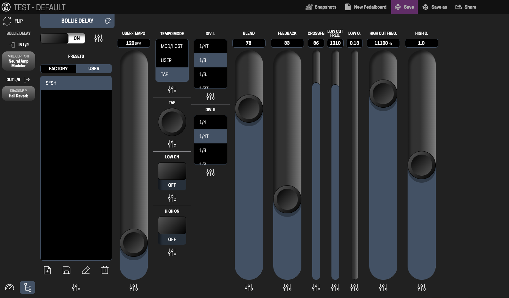

# mod-ui-nhe

Extensions for the [MOD](https://mod.audio) web UI (MOD Duo, Duo X, Dwarf, MOD Desktop), kept **outside MOD's code**.



## What it adds

- **A new plugin settings screen.** A pedal's gear opens big, touch-friendly controls in place of MOD's knobs: sliders, toggles, triggers, option lists, presets and file lists (NAM models, IRs), stacked into columns that fit the screen and scroll sideways. A system bar on the left shows tempo, CPU / RAM and the signal chain; tap a neighbouring plugin to jump to it. The **NHE / MOD** switch at the top right brings back MOD's own panel.
- **A clearer assignment dialog.** A control's settings icon opens one screen for assigning it to a footswitch, knob, MIDI, Control Chain or CV, with its label, range and options.
- **Plugin colours.** Give each plugin one of MOD's colours in place of the purple.
- **A performance view.** The bolt icon in the footer shows your pedals one at a time, as big as the screen allows. **Flip** a pedal to get to its settings on the back; **Hide** the ones you don't need while playing.

Values, presets and assignments all go through MOD's own code, so everything stays in step with MOD's editor, the device and other browsers. On the device NHE adds its own folder and two small hooks into MOD's page, and nothing else (see "How it fits into MOD").

## Install it on your MOD

You need a Mac or Linux computer (on Windows, use [WSL](https://learn.microsoft.com/windows/wsl/)) and your MOD device connected over USB.

1. **Get this repository.** Either `git clone https://github.com/Kiwooky/MOD-ui-NHE.git`, or on GitHub choose **Code → Download ZIP** and unzip it.
2. **Connect the MOD** over USB and check that http://192.168.51.1 opens MOD's web UI in your browser.
3. **Run the installer** from the repository's folder, in a terminal:

   ```sh
   sh tools/deploy.sh
   ```

   It asks for the MOD's password twice: it is `mod`. (Run `ssh-copy-id root@192.168.51.1` once and it won't ask again.)
4. **Reload** http://192.168.51.1. No reboot is needed.

For a MOD on your network instead of USB, add its address: `sh tools/deploy.sh 192.168.1.50`.

- **Update:** get the new version of the repository and run `sh tools/deploy.sh` again.
- **After a MOD OS update:** run `sh tools/deploy.sh` again (the update removes the hooks).
- **Uninstall:** `ssh root@192.168.51.1 'sh /data/nhe/device/uninstall.sh'` puts MOD's original page back.
- Use **one MOD tab at a time**: MOD's UI expects one browser, and a second tab can hang on "Loading pedalboard…".

Status and what's next: [ROADMAP.md](ROADMAP.md).

## How it fits into MOD

On the device, NHE touches MOD's files in exactly two places:

1. a link `/usr/share/mod/html/nhe` → `/data/nhe` (where this repo's `nhe/` folder lives)
2. one `<script>` tag for `nhe/loader.js` in MOD's `index.html`

Everything else is in `/data`, so it survives reboots. A MOD OS update removes the two hooks; run the install script again to put them back.

```
nhe/
  loader.js              the one file index.html loads; reads version.json, loads features
  version.json           bumped on deploy so browsers fetch new files
  adapter/mod.js         the ONLY code that touches MOD's internals
  theme/tokens.css       design tokens (--nhe-*), exported from the Figma file's Variables
  components/            the NHE controls:
    icons.js             icons exported from the Figma file
    slider/              the slider that will replace MOD's knob
    controls/            toggle, trigger, plugin header, buttons, option list, preset list,
                         system bar (systembar.js), the panel layout with stacking (panel.js),
                         the addressing dialog (addressing.js), plugin colours (colour.js),
                         the name dialog (name.js)
  features/performance/  performance.js + .css (shared with the mod-ui branch) and index.js (wiring)
  features/settings/     the NHE plugin settings panel in MOD's settings window (NHE / MOD switch)
  device/install.sh      run on the device: hooks NHE into MOD's UI (safe to repeat)
  device/uninstall.sh    run on the device: restores MOD's original index.html
tools/
  devproxy.js            local preview: MOD's real UI + this repo's files, live
  deploy.sh              copy to the device and install
playground/              component playgrounds, no MOD needed (npm run playground)
docs/                    specs (slider, buttons, selects, system bar, addressing, plugin colour, performance flip)
test/                    browser tests (see test/README.md)
```

## Work on it locally (MOD Desktop)

1. Start **MOD Desktop**. It serves MOD's UI at http://127.0.0.1:18181.
2. In this folder: `npm run dev`. No `npm install` is needed; it uses Node built-ins only.
3. Open **http://localhost:18080**: MOD's real UI, with `./nhe` served live from this folder. Edit, reload, see it. Nothing in MOD Desktop is changed.

To preview against the Duo instead (over USB): `npm run dev:duo`.

MOD Desktop hides the device-only parts of the UI (File Manager, Banks, Plugin Store, Settings, hardware addressing). Work on those against the Duo.

## The settings panel

With the `settings` feature on (the default), a pedal's gear opens MOD's settings window with the NHE screen: sliders, toggles, triggers, option lists, presets, file lists and plugin on/off, stacked into columns. The **NHE / MOD** switch at the top right shows MOD's own panel instead. Values go through MOD's own path both ways, bindings show as shared or locked, and the addressing dialog, presets and on/off drive MOD's existing functions. Under the plugin's name: its colour, its info page, and delete (after a yes; what fed it is then connected straight to what it fed, as if it were bypassed). The system bar sits on the left (tempo, CPU / RAM, the signal chain; EXIT closes the window). Text settings (e.g. Button to CV's texts) aren't handled yet: use the MOD view for those. The same screen is the back of a flipped pedal in the performance view.

Turn it off with `NHE.mod.setPreference('nhe-settings', 'false')`.

## Your settings

NHE's settings (plugin colours, which editor, builder and menus, the work surface, the performance view's layout, and each board's cable colours, hand-laid cables and grid size in NHE's builder) are kept on the MOD itself, in MOD's own preferences (`nhe-config`): every browser that opens that MOD gets them, and two MODs keep their own. SET → **Settings file** exports them to a `.json` file, labelled with the MOD it came from, and imports one (into this MOD or another). `nhe/components/config.js` does it: it mirrors NHE's keys in the browser's localStorage, so features keep using localStorage as before.

## Try components on their own

`npm run playground`, then open http://localhost:18090/playground/slider.html (the slider with a properties panel, an event log, a sample settings panel and a theme-colour picker) or http://localhost:18090/playground/controls.html (every other control, the system bar, and a full settings panel laid out with stacking, at different heights). It needs no MOD. (The same page is at /playground/slider.html on the `npm run dev` proxy.) Open only the playground page on :18090, not its root: the root is MOD's UI, and MOD wants one tab at a time.

## Deploying while developing

`npm run deploy` is `tools/deploy.sh` (see "Install it on your MOD"): it copies `nhe/` to `/data/nhe`, then runs `device/install.sh` on the device, and stamps a new version so browsers fetch the new files.

## Switching features off

Each feature can be turned off with a MOD preference `nhe-<feature>` = `"false"`, stored on the device like MOD's own settings:

```js
NHE.mod.setPreference('nhe-performance', 'false')   // in the browser console; reload
```

## Requirements

- MOD OS 1.14 (tested against 1.14 RC4, `v1.14.0.3366`) or MOD Desktop on the same version.
- A browser at least as new as MOD 1.14 needs: iOS/iPadOS 13.4+; for the performance view, Safari 14.1+ or any current Chrome, Firefox or Edge.

## Licence

AGPL-3.0-or-later, like mod-ui ([LICENSE](LICENSE)). © 2026 New Horizon Electronics.

MOD, MOD Duo, Duo X, Dwarf and MOD Desktop are products of MOD Audio. This is an independent extension, not affiliated with or endorsed by MOD Audio.
